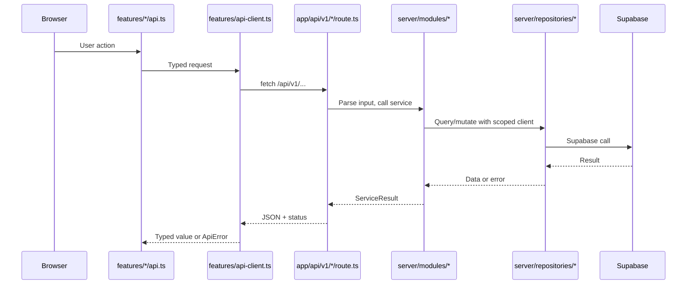

# Commun.dev architecture

This document describes the deployed Next.js application, not the historical static prototypes that remain in the repository.

## 1. System shape

Commun.dev is a single Next.js 16 App Router deployment backed by Supabase. The root application is the source of truth. We deliberately avoided a physical monorepo conversion because the deployment is one Vercel project and a folder-only split would add risk without adding a deployment boundary. Instead, the application uses strict logical boundaries.

```text
app/                         Next.js routes and pages
├── api/v1/                  Canonical versioned HTTP adapters
├── api/*                    Legacy compatibility re-exports
├── (pages)/                 Server and client pages
server/
├── http/                    Shared request/response/auth helpers
├── modules/                 Domain business services
└── repositories/            Supabase data access
features/
├── api-client.ts            Centralized typed frontend HTTP client
└── */api.ts                 Feature-scoped frontend API services
packages/shared/             Shared types, schemas, constants, utilities
components/                  React components and shared UI primitives
lib/                         Cross-cutting helpers and integrations
supabase/migrations/         Database schema and policy history
```

## 2. Request lifecycle

### Social core (fully layered path)



`server/http/result.ts` converts domain outcomes into HTTP responses using a small `success`/`failure` result object. `server/http/response.ts` owns bounded JSON body reading and common response headers. `server/http/auth.ts` builds the request-scoped authenticated Supabase client.

### Auxiliary endpoints (same layered path)

Admin, moderation, billing, reports, feedback, analytics, and news use the same adapter → service → repository path as the social core. Their services live in `server/modules/{admin,moderation,reports,billing,product-telemetry,news}/service.ts`, with Supabase access in `server/repositories/*`. Provider-driven integrations (the Stripe webhook and Supabase auth callback) remain unversioned at the HTTP boundary by design.

## 3. Frontend boundary

`features/api-client.ts` is the only module allowed to call `fetch('/api/...')`. It:

- prefixes all relative paths with `API_BASE` (`/api/v1`);
- serializes JSON bodies and sets `content-type`;
- parses empty `204` responses safely;
- maps HTTP failures to `ApiError`, `SessionExpiredError`, or `NetworkError`;
- preserves structured validation payloads and `Retry-After` headers;
- exposes `errorMessage()` for consistent UI messages.

Feature modules such as `features/posts/api.ts`, `features/profiles/api.ts`, and `features/billing/api.ts` define typed operations. Components import those services instead of constructing URLs. The only remaining literal `/api/` string in live TypeScript is inside a code-sample string in a landing preview component.

## 4. API boundary

`/api/v1/*` is the canonical API surface. Legacy `/api/*` routes remain as thin re-exports so existing clients and bookmarks continue to work. Both paths return the same response contract.

Route categories:

| Category | Examples | Ownership |
| --- | --- | --- |
| Layered social core | feed, posts, social-posts, comments, replies, discussions, reactions, follows, profiles, search, notifications | v1 adapters → services → repositories |
| Layered trust and product domains | admin, moderation, billing, reports, feedback, analytics, news | v1 adapters → services → repositories |
| Intentional non-versioned integrations | `/api/webhooks/stripe`, `/auth/callback` | Provider callbacks signed by Stripe or Supabase; versioning them would not improve client compatibility |

`server/http/boundaries.test.ts` guards this structure: every v1 route must delegate to `toResponse`, and every legacy route except the provider webhook must be a compatibility re-export.

See `docs/api-contracts.md` for the endpoint inventory.

## 5. Shared package

`packages/shared` contains transport-level contracts imported through the `@shared/*` alias:

- `types/api.ts` — feed page, post, comment, discussion, notification, search, and interaction views;
- `schemas/index.ts` — reusable Zod schemas;
- `constants/index.ts` — `API_BASE`, notification types, search types;
- `utils/index.ts` — shared pure helpers.

`tsconfig.json` and `vitest.config.ts` both map `@shared/*` so application and test resolution agree.

## 6. Authentication and authorization

- Supabase Auth issues the session cookie.
- Server helpers derive role and status from verified JWT app metadata, never from browser payloads.
- Row-level security protects user-scoped data.
- Admin and moderation routes require explicit role checks before using the service-role client.
- Ownership is derived from the authenticated user id.
- Billing mutations re-check active account status and rate limits.
- Webhook fulfillment trusts only Stripe signature verification, never a success redirect.

## 7. Theme strategy

The application is light-only:

- `app/globals.css` sets `color-scheme: light` and semantic CSS variables.
- `tailwind.config.ts` maps Tailwind utilities to those variables.
- `lib/design-tokens.ts` documents the palette in TypeScript and is covered by tests.
- `app/layout.tsx` sets the browser theme color to `#FFFFFF`.
- No `ThemeProvider`, `next-themes`, `dark:` utilities, or `prefers-color-scheme` inversion exists in the live app.

`components/ui/cinematic-landing-hero.tsx` is a standalone light-themed product story. Its device hardware and screen now use light product surfaces and honest links to `/register` and `/feed`. The dark styles in root static prototypes are not imported by Next.js.

## 8. Error and empty-state policy

- API errors use `{ error: string, issues?: ... }` with meaningful HTTP status codes.
- Frontend services surface the server message when present, otherwise a stable generic fallback.
- Unavailable product surfaces render explicit “unavailable” or “in development” states instead of fabricated records.
- Marketing sections marked “Soon” are not linked as if they were implemented.

## 9. Deployment boundary

The repository root is deployed as one Next.js application. Logical layering is enforced by convention and import direction:

```text
components → features → api-client → app/api/v1 → server/modules → server/repositories → Supabase
```

Reverse imports (server code importing components, repositories importing route handlers, or v1 routes importing legacy routes) should be rejected in review.

## 10. Non-goals for this phase

- No migration from React/Next.js/Supabase to another stack.
- No physical monorepo split or second deployment.
- No new communities, messaging, jobs, project showcase persistence, or work-management data model.
- No production deployment, migration, or data change performed as part of this architecture work.
